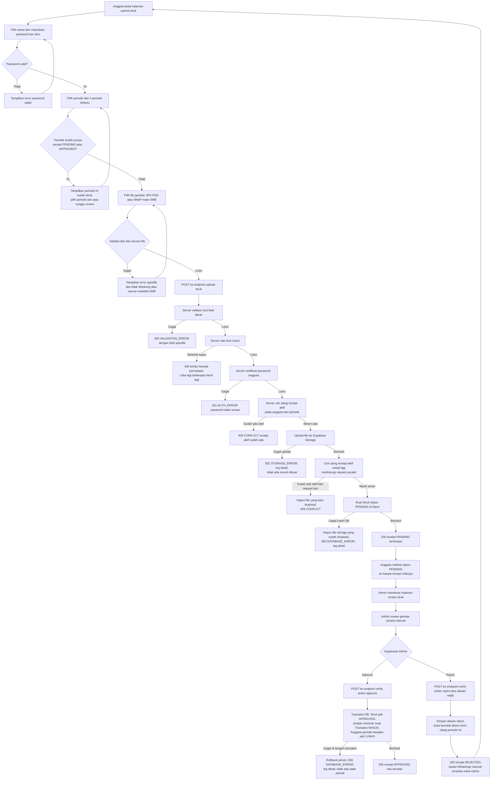
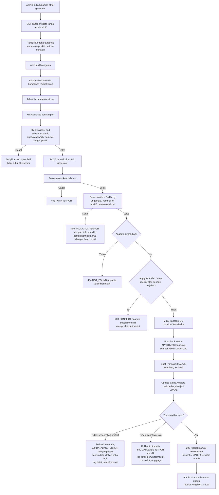
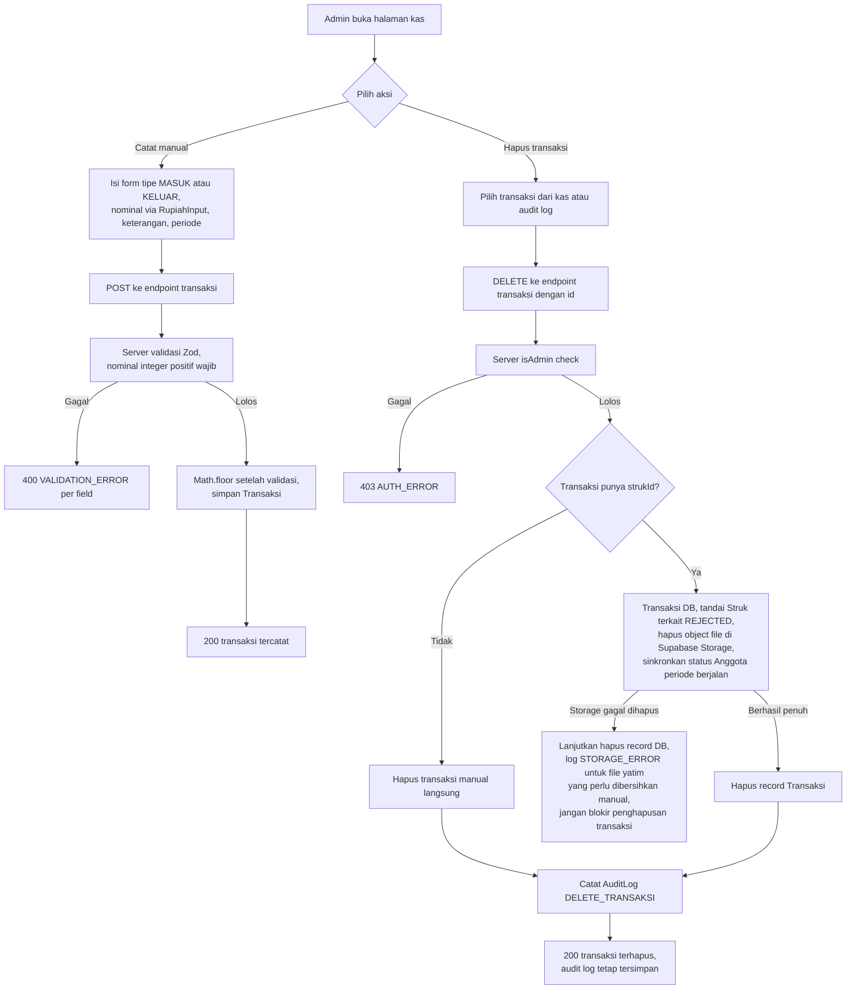
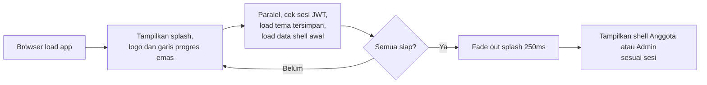

# Architecture

## Status Dokumen

Dokumen ini adalah **spesifikasi untuk dibangun dari nol**, bukan deskripsi kode yang sudah berjalan. Kode pada repository lama (`htn-legacy` versi sebelumnya) ditinggalkan sepenuhnya. Fitur yang dibangun tetap sama dengan versi sebelumnya; yang berubah adalah kedalaman alur kerja dan standar penanganan error, yang dirancang eksplisit untuk mencegah dua kelas bug yang pernah terjadi:

1. Validasi nominal uang yang menolak input wajar (native HTML `step` validation yang salah konfigurasi).
2. Error 500 generik tanpa pesan yang bisa ditindaklanjuti pengguna maupun developer.

Aplikasi menggunakan Next.js App Router, Prisma dengan PostgreSQL Neon, dan Supabase Storage.

## Komponen Utama

- Next.js 16 App Router menangani halaman, Server Component, Client Component, proxy, dan API Route Handler.
- TypeScript menjadi bahasa utama, `strict: true` di `tsconfig.json`.
- Prisma Client terhubung ke PostgreSQL Neon melalui `DATABASE_URL` dan `DIRECT_URL`.
- Supabase Storage menyimpan gambar receipt dan barcode. Database hanya menyimpan path object.
- JWT httpOnly cookie digunakan untuk session anggota dan Admin. Session Admin
  kedaluwarsa setelah 30 menit, sedangkan session anggota berlaku 7 hari.
- Password anggota dienkripsi dengan AES-256-GCM.
- Zod digunakan sebagai satu-satunya mekanisme validasi skema di server, untuk setiap Route Handler yang menerima input.
- `lucide-react` digunakan sebagai satu-satunya icon library fungsional; Bootstrap Icons khusus untuk brand mark sosial media (lihat `DESIGN.md`).
- `next-themes` mengatur tema terang, gelap, dan preferensi sistem.
- Bun digunakan sebagai package manager dan runtime tooling.

## Batasan Service

- Tidak ada OCR otomatis.
- Tidak ada Gemini atau AI fallback.
- Tidak ada Python OCR service.
- Tidak ada `OCR_SERVICE_URL`, `GEMINI_API_KEY`, atau `GEMINI_MODEL`.
- WhatsApp hanya menggunakan link manual `wa.me`. Tidak ada WAHA, session WhatsApp, webhook, atau worker WhatsApp 24/7.

## Standar Input Nominal (Wajib)

Ini adalah perbaikan struktural langsung dari bug yang pernah terjadi: field nominal menolak angka wajar (`10000` ditolak, disarankan `9501`/`10001`) karena memakai `<input type="number">` dengan atribut `step` yang tidak sesuai untuk mata uang Rupiah.

Aturan wajib untuk **setiap** field nominal uang di seluruh aplikasi (kas manual, struk generator, nominal iuran di settings):

1. Satu komponen bersama `components/ui/rupiah-input.tsx` dipakai ulang di semua form nominal. Dilarang membuat field nominal baru di luar komponen ini.
2. Elemen dasar **wajib** `<input type="text" inputMode="numeric">`, **dilarang** `type="number"`. Browser native number validation (`step`, `min`, `max` pada `type="number"`) adalah sumber bug yang terjadi sebelumnya dan tidak boleh dipakai untuk nominal uang.
3. Atribut `pattern="[0-9]*"` juga **dilarang** untuk alasan yang sama. Nilai yang ditampilkan terformat mengandung pemisah ribuan, sehingga pattern native menolak nilai yang sebenarnya valid ("10.000") dengan pesan "Please match the requested format." Filter non-digit di `onChange` sudah cukup, dan validasi akhir tetap di server lewat Zod.
4. Nilai yang disimpan di state adalah integer polos tanpa separator (`15000`), nilai yang ditampilkan ke user diformat dengan pemisah ribuan (`15.000`) secara real-time saat mengetik, menggunakan `Intl.NumberFormat('id-ID')`.
5. Posisi caret dipulihkan ke digit yang sama setelah nilai berubah, supaya nominal bisa diedit di tengah nilai terformat. Tanpa ini, caret melompat ke akhir setiap kali nilai ditulis ulang dan pengeditan di tengah tidak mungkin dilakukan.
6. Validasi di client: hanya menolak karakter non-digit saat input (filter saat `onChange`), tidak ada pembatasan `step`, `min` yang aneh, atau kelipatan tertentu kecuali memang disyaratkan bisnis (misal "nominal harus lebih dari 0").
7. Batas atas nominal adalah 2.000.000.000, mengikuti kapasitas kolom `Int` (32 bit) di PostgreSQL. Batas yang sama diverifikasi ulang di server lewat Zod, supaya angka yang pasti gagal disimpan tidak pernah sampai ke database.
8. Validasi final selalu terjadi di server lewat skema Zod (`z.number().int().positive()`), bukan hanya di client.
9. Komponen menampilkan prefiks `Rp` statis dan baris bantuan preview format penuh (contoh: "Preview: Rp 15.000") agar user memastikan nilai yang dimasukkan benar.

## Standar Error Handling API (Wajib)

Ini adalah perbaikan struktural langsung dari bug error 500 generik ("Gagal membuat struk manual") yang tidak memberi informasi apapun untuk ditelusuri.

Setiap Route Handler di `src/app/api/**` wajib mengikuti kontrak berikut:

1. **Validasi input terstruktur**: setiap body/query/form divalidasi dengan skema Zod di awal handler. Kegagalan validasi mengembalikan `400` dengan daftar field yang gagal dan alasannya, bukan pesan generik.
2. **Error terklasifikasi**: setiap kegagalan di luar validasi input diklasifikasikan ke salah satu kategori berikut sebelum dikembalikan ke client:
   - `VALIDATION_ERROR` (400) - input tidak valid menurut skema atau aturan bisnis (contoh: periode sudah terisi).
   - `AUTH_ERROR` (401/403) - sesi tidak valid atau tidak memiliki izin.
   - `NOT_FOUND` (404) - entitas yang dirujuk tidak ada.
   - `CONFLICT` (409) - race condition atau state yang sudah berubah (contoh: receipt aktif kedua pada periode sama).
   - `STORAGE_ERROR` (502) - kegagalan upload/hapus ke Supabase Storage.
   - `DATABASE_ERROR` (500) - kegagalan transaksi Prisma yang tidak terduga.
   - `INTERNAL_ERROR` (500) - kegagalan lain yang tidak terklasifikasi; kategori ini adalah fallback terakhir, bukan default pertama.
3. **Pesan ke client selalu spesifik dan dalam Bahasa Indonesia**, menjelaskan apa yang gagal dan jika memungkinkan apa yang harus dilakukan user. Dilarang mengembalikan pesan generik seperti "Terjadi kesalahan" atau "Gagal membuat struk manual" tanpa konteks tambahan. Contoh pesan yang benar: "Gagal membuat struk manual: anggota ini sudah memiliki receipt PENDING pada periode 2026-10."
4. **Logging server wajib** untuk setiap error kategori `STORAGE_ERROR`, `DATABASE_ERROR`, dan `INTERNAL_ERROR`: catat `requestId`, endpoint, kategori error, pesan error asli (termasuk stack trace di server log, tidak dikirim ke client), dan payload yang relevan (tanpa data sensitif seperti password). Ini memungkinkan penelusuran lewat Vercel Function Logs tanpa harus mereproduksi bug secara manual.
   Helper menerima endpoint dan payload non-sensitif secara eksplisit agar setiap log dapat dikorelasikan tanpa mencatat password atau secret.
5. Setiap Route Handler mengembalikan bentuk response yang konsisten:

```ts
// Sukses
{ success: true, data: T }

// Gagal
{
  success: false,
  error: {
    category: "VALIDATION_ERROR" | "AUTH_ERROR" | "NOT_FOUND" | "CONFLICT" | "STORAGE_ERROR" | "DATABASE_ERROR" | "INTERNAL_ERROR",
    message: string,       // pesan spesifik, siap ditampilkan ke user
    fields?: Record<string, string>, // khusus VALIDATION_ERROR, per-field
    requestId: string,     // untuk korelasi dengan server log
  }
}
```

6. Helper bersama `src/lib/api-response.ts` menyediakan fungsi `apiSuccess()` dan `apiError()` agar bentuk response konsisten di semua handler tanpa duplikasi logic.
7. `z.config(z.locales.id())` diaktifkan di `src/lib/api-response.ts` supaya pesan validasi bawaan Zod yang diteruskan ke client berbahasa Indonesia.
8. Rate limit upload memakai kategori `VALIDATION_ERROR` dengan status HTTP 429 yang eksplisit, karena tujuh kategori di atas bersifat eksklusif. Kunci rate limit menggabungkan IP dan anggota, sehingga request dari sumber lain tidak bisa mengunci anggota tertentu.
9. Endpoint yang hanya membaca data juga wajib memeriksa session. Tanpa session anggota maupun session Admin, request ditolak dengan kategori `AUTH_ERROR` dan status 401.

## Alur Receipt Anggota (Detail)



Catatan non-visual yang tidak bisa diwakili diagram:

- Server tidak membaca isi gambar. Receipt yang buram atau tidak terbaca tetap masuk antrean selama data dasar dan file valid.
- Setiap langkah bertanda "gagal" di atas mengikuti kontrak error pada bagian "Standar Error Handling API" di atas - bukan pesan generik.
- `N1` dan `O1` adalah mekanisme kompensasi manual (bukan transaksi database, karena melibatkan storage eksternal): jika langkah setelah upload gagal, file yang sudah terlanjur terupload wajib dihapus agar tidak ada file yatim di Supabase Storage.

Aturan periode:

- Periode berjalan dan tiga bulan sebelumnya dapat dipilih (`MAX_RECEIPT_MONTHS = 4`).
- Satu anggota hanya boleh memiliki satu receipt aktif per periode.
- `PENDING` dan `APPROVED` memblokir pengiriman kedua pada periode yang sama.
- `REJECTED` dapat dikirim ulang.
- Perlindungan dilakukan di server dan diperiksa kembali tepat sebelum `db.struk.create` (lihat node `N` pada diagram), untuk melindungi dari request paralel atau request stale.

## Alur Receipt Generator Admin (Detail)

Ini adalah alur yang sebelumnya gagal dengan error 500 generik. Diagram berikut merinci setiap titik kegagalan agar error spesifik selalu tersedia.



Titik kegagalan spesifik yang **wajib** diuji sebelum dianggap selesai:

- `H`/`K`: nominal bukan angka positif, nominal kosong, nominal mengandung karakter non-digit.
- `L1`: `anggotaId` valid secara format tapi tidak ada di database (dihapus di antara load daftar dan submit).
- `M1`: anggota sudah mendapat receipt aktif dari jalur lain (misal upload mandiri) tepat sebelum Admin submit - race condition yang sama polanya dengan alur anggota.
- `R1`/`R2`: ini yang sebelumnya muncul sebagai 500 tanpa detail. Dengan isolation level `Serializable`, konflik transaksi paralel harus eksplisit ditangkap dan diberi pesan "konflik data, silakan coba lagi" ke user, bukan dibiarkan jatuh ke generic error handler Next.js.

## Approval dan Rejection

Approval dijalankan dalam transaksi database (lihat node `W` pada diagram alur receipt anggota). Record receipt menjadi `APPROVED`, nominal receipt disimpan, transaksi `MASUK` dibuat, dan status anggota periode berjalan menjadi `LUNAS`. Seluruh langkah ini atomik; jika salah satu gagal, seluruhnya rollback dan dikembalikan sebagai `DATABASE_ERROR` dengan detail yang di-log.

Receipt historis tetap dicatat pada periode asalnya, tetapi tidak mengubah status pembayaran periode berjalan.

Rejection menyimpan alasan dan membuka pengiriman ulang pada periode tersebut. Tautan WhatsApp manual dapat dibuat untuk Admin, tetapi tidak ada pengiriman otomatis.

## Alur Kas dan Penghapusan



- Transaksi manual dicatat melalui `/api/transaksi`.
- Admin dapat menghapus transaksi `MASUK` maupun `KELUAR` dari halaman kas.
- Transaksi yang terkait receipt juga dapat dihapus; lihat node `M` di atas untuk urutan sinkronisasi.
- Tombol penghapusan juga tersedia pada Audit Log untuk aktivitas transaksi yang memiliki referensi transaksi.
- Audit log tidak ikut dihapus. Aksi penghapusan dicatat sebagai `DELETE_TRANSAKSI` agar tetap menjadi jejak audit, bahkan ketika penghapusan file storage gagal sebagian (node `M1`) - kegagalan storage tidak boleh memblokir integritas data transaksi/audit.

## Penyimpanan File

```text
struk/{YYYY-MM}/{filename}
assets/barcode-{timestamp}.{extension}
```

Path object disimpan pada database. URL yang dikirim ke UI adalah signed URL dengan masa berlaku terbatas. Secret Supabase hanya digunakan di server.

Aturan tambahan:

- Path objek storage tidak boleh dikirim apa adanya ke client sebagai URL. Selalu kirim URL siap pakai hasil `getSignedUrl()`, misalnya `barcodeUrl` pada `GET /api/settings` dan `fileUrl` pada `POST /api/admin/struk-generator`. Path mentah yang dipakai sebagai atribut `src` akan menghasilkan 404 atau error `next/image`.
- Ekstensi file diturunkan dari peta MIME type ke ekstensi, sehingga `image/svg+xml` menghasilkan ekstensi `svg` dan bukan `svg+xml`.
- Record `Struk` memakai unique constraint `[anggotaId, periodeBulan, status]`. Karena itu penolakan kedua pada periode yang sama harus diklasifikasikan sebagai `CONFLICT` (409) dengan pesan spesifik, bukan dibiarkan jatuh ke generic error handler.
- Menghapus anggota juga menghapus file receipt-nya. Kegagalan hapus file tidak memblokir penghapusan record, tapi dicatat sebagai `STORAGE_ERROR` untuk pembersihan manual.

## Model Data

- `Anggota`: identitas, kontak, password terenkripsi, dan status pembayaran periode berjalan.
- `Struk`: file receipt, periode, status review, nominal, catatan, sumber manual/admin, dan alasan rejection.
- `Transaksi`: pemasukan/pengeluaran historis yang dapat terhubung ke anggota dan receipt.
- `Settings`: nominal iuran, deadline, barcode, dan kontak pengurus.
- `AuditLog`: histori aksi Admin.

## Route Penting

- Anggota: `/login`, `/signup`, `/beranda`, `/profil`, `/barcode`, `/kas`, `/daftar/[jenis]`.
- Admin: `/admin/dashboard`, `/admin/anggota`, `/admin/struk`, `/admin/struk-generator`, `/admin/kas`, `/admin/import`, `/admin/audit-log`, `/admin/settings`, `/admin/laporan`.
- Receipt: `/api/struk/upload`, `/api/struk/[id]/verify`, `/api/anggota/[id]/struk`.
- Kas: `/api/transaksi`, `/api/transaksi/[id]`.
- Generator: `/api/admin/struk-generator`, `/api/admin/struk-generator/anggota`.

## Splash Screen (Loading Awal)



Detail visual dan aturan durasi ada di `DESIGN.md` bagian "Splash Screen". Implementasi sebagai komponen client (`app/splash.tsx` atau setara) yang membungkus root layout, bukan halaman terpisah, agar tidak menimbulkan flash of unstyled content.

## Deployment

Build menggunakan Next.js standalone dan `scripts/copy-standalone.mjs`. Deployment production memerlukan environment Neon, Supabase Storage, JWT, enkripsi, dan password Admin.

Sebelum aplikasi start, database harus dimigrasikan:

```text
bunx prisma migrate deploy
```

Migration memakai model standard Prisma (`prisma/migrations/`), sehingga `prisma migrate deploy` aman dijalankan berulang kali dan tidak menghapus data. Migration baseline menandai schema yang sudah ada di Neon sebagai sudah diterapkan tanpa menjalankannya, lalu migration berikutnya memetakan kolom lama ke kolom baru memakai `ALTER TABLE ... RENAME COLUMN`, bukan drop lalu buat ulang.

Validasi standar:

```text
bunx tsc --noEmit
bun run lint
bun run build
git diff --check
```

Gunakan Node.js 22 untuk deployment baru karena Supabase JS memberikan peringatan deprecation pada Node.js 20 dan di bawahnya.
