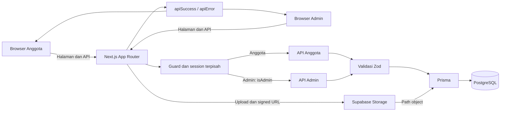
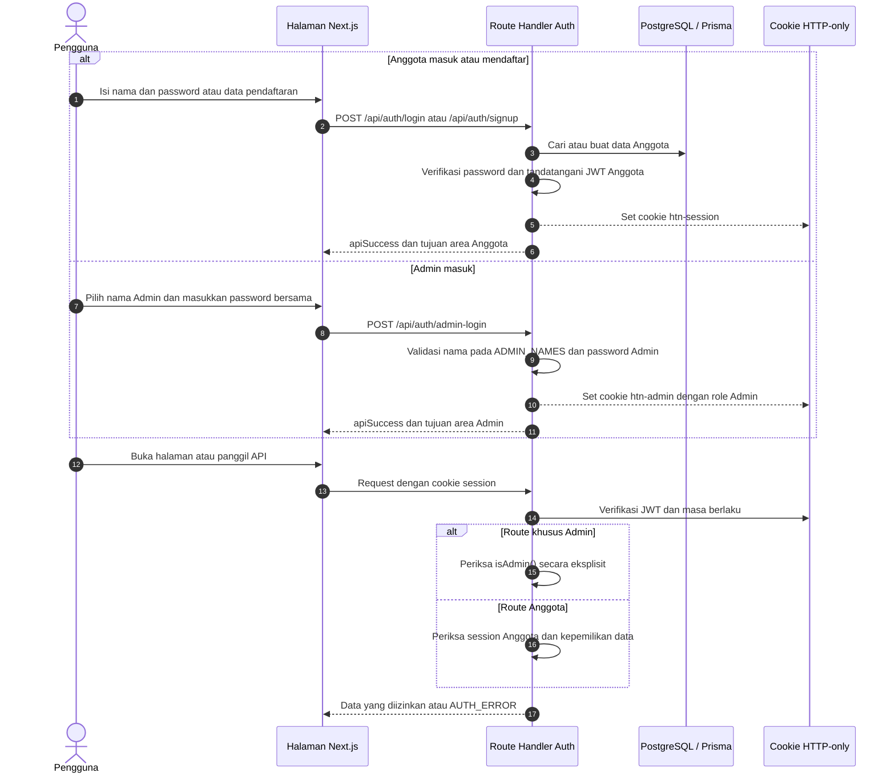
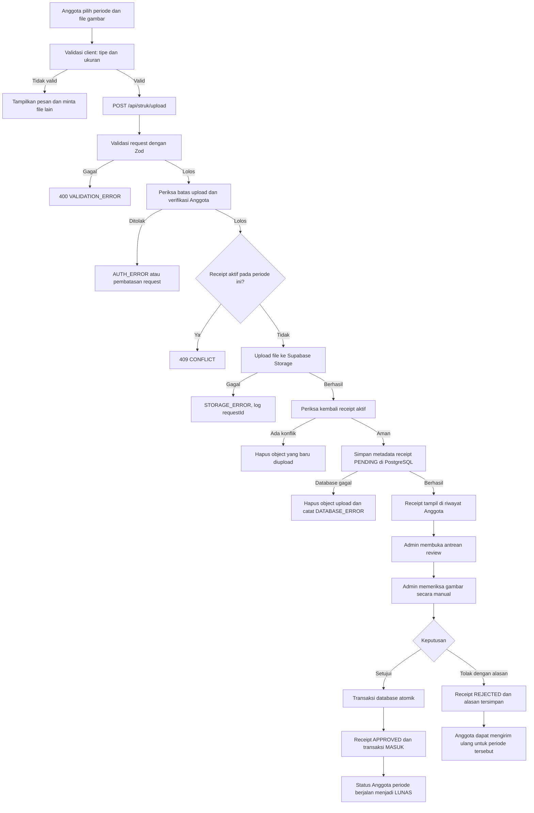
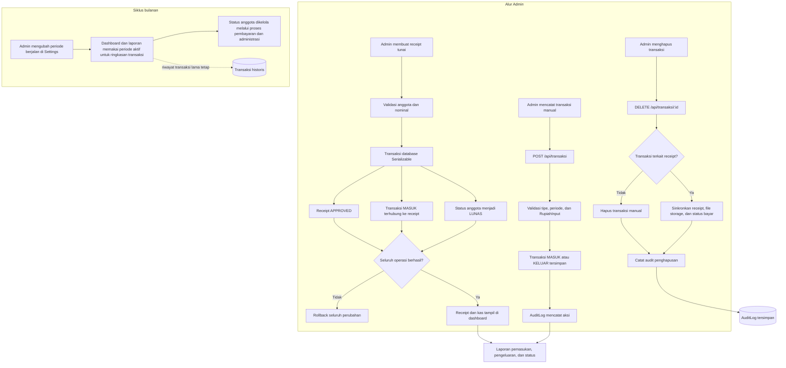
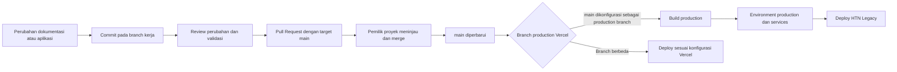

# HTN Legacy

HTN Legacy adalah aplikasi internal untuk mengelola iuran anggota, bukti pembayaran, kas organisasi, laporan, dan jejak audit. Aplikasi menyediakan area Anggota dan Admin dengan otorisasi terpisah.

## Fitur

- Login dan pendaftaran Anggota serta login Admin pada route terpisah.
- Status pembayaran periode berjalan: `LUNAS`, `BELUM_LUNAS`, dan `TERTUNGGAK`.
- Pengiriman bukti pembayaran oleh Anggota dan pemeriksaan manual oleh Admin.
- Pembuatan receipt manual untuk pembayaran tunai, tercatat bersama transaksi kas.
- Pengelolaan anggota, import, pengaturan iuran, barcode pembayaran, dan siklus bulanan.
- Pencatatan pemasukan dan pengeluaran, laporan, serta audit log Admin.
- Tema terang, gelap, dan system.
- Tautan WhatsApp `wa.me` yang dibuka secara manual. Aplikasi tidak menjalankan layanan pesan otomatis.

Pemeriksaan receipt dilakukan oleh manusia. Aplikasi tidak menjalankan OCR, Gemini, atau keputusan otomatis berdasarkan isi gambar.

## Stack

- Next.js 16 App Router, React 19, dan TypeScript strict.
- Bun untuk instalasi dependency dan perintah pengembangan.
- Prisma dengan PostgreSQL.
- Supabase Storage untuk file receipt dan barcode pada production. Adapter dapat memakai storage lokal untuk development. Database menyimpan path object, bukan isi file.
- JWT bertanda tangan `jose` di cookie HTTP-only. Cookie dan pemeriksaan session Admin serta Anggota terpisah.
- Zod untuk validasi request server.
- AES-256-GCM untuk penyimpanan password Anggota pada implementasi saat ini.
- Tailwind CSS, `next-themes`, dan `lucide-react`.

## Gambaran arsitektur



Route Handler mengembalikan response konsisten. Error memiliki kategori, pesan Bahasa Indonesia, dan `requestId`. Kegagalan database, storage, dan internal dicatat di server log dengan konteks yang dapat ditelusuri tanpa mengirim secret ke client.

## Alur kerja aplikasi

### Session dan akses



Nama Admin yang tersedia dikonfigurasi melalui `ADMIN_NAMES`, dipisahkan koma, sesuai implementasi saat ini. Password Admin dipakai bersama. Hak akses Admin tidak dibedakan berdasarkan nama.

### Upload dan review receipt Anggota



File gambar disimpan di Supabase Storage; PostgreSQL menyimpan metadata dan path object. Signed URL dipakai saat UI perlu menampilkan file. Server tidak membaca isi gambar untuk mengambil keputusan otomatis.

### Receipt manual, kas, dan siklus bulanan



Receipt Generator membuat receipt `APPROVED`, transaksi `MASUK`, dan pembaruan status anggota dalam satu transaksi database. Perubahan periode tidak menghapus riwayat transaksi.

## Route utama

| Area | Route | Kegunaan |
| --- | --- | --- |
| Anggota | `/login`, `/signup` | Login dan pendaftaran |
| Anggota | `/beranda`, `/profil`, `/barcode`, `/kas`, `/daftar/[jenis]` | Informasi dan aktivitas Anggota |
| Admin | `/admin/login` | Login Admin terpisah |
| Admin | `/admin` | Dashboard dan navigasi pengelolaan |
| Auth API | `/api/auth/login`, `/api/auth/signup`, `/api/auth/admin-login`, `/api/auth/logout`, `/api/auth/session` | Session dan autentikasi |
| Receipt API | `/api/struk`, `/api/struk/upload`, `/api/struk/[id]/verify` | Daftar, upload, dan review receipt |
| Admin API | `/api/admin/struk-generator`, `/api/admin/struk-generator/anggota`, `/api/admin/audit-log` | Receipt manual, daftar anggota yang tersedia, dan audit log |
| Data API | `/api/anggota`, `/api/transaksi`, `/api/dashboard`, `/api/laporan`, `/api/settings` | Anggota, kas, dashboard, laporan, pengaturan |

Route Admin harus memeriksa `isAdmin()` secara eksplisit. API bersama yang dapat diakses Anggota dan Admin harus menerapkan pemeriksaan session serta batas kepemilikan data.

## Struktur repository

```text
src/
  app/                 Halaman App Router, layout, dan API Route Handler
  components/          Shell, views, blocks, dan komponen UI
  lib/                 Auth, database, storage, response API, dan utilitas
prisma/
  schema.prisma        Model data PostgreSQL
scripts/               Build standalone dan skrip bantu
docs/                  Spesifikasi produk, arsitektur, dan design system
public/                Aset statis yang aman untuk publik
```

File receipt dan barcode yang berasal dari pengguna tidak boleh ditambahkan ke repository. Gunakan batas storage yang disediakan aplikasi.

## Menjalankan secara lokal

### Prasyarat

- Bun.
- Node.js 22 untuk lingkungan deployment yang mengikuti rekomendasi arsitektur.
- PostgreSQL yang dapat diakses aplikasi.
- Project Supabase Storage untuk receipt dan barcode.

### Persiapan

1. Pasang dependency dengan `bun install`.
2. Salin `.env.example` menjadi `.env` dan isi konfigurasi yang valid.
3. Pastikan `DATABASE_URL` dan `DIRECT_URL` menunjuk ke PostgreSQL. Prisma schema menggunakan provider PostgreSQL.
4. Isi secret JWT, password Admin, nama Admin, kunci enkripsi, dan konfigurasi Supabase. Jangan gunakan nilai contoh untuk lingkungan bersama atau production.
5. Jalankan `bun run db:generate` setelah instalasi atau perubahan schema.
6. Siapkan schema database menggunakan migration yang sudah direview, atau prosedur database development yang disetujui tim.
7. Jalankan `bun run dev`, lalu buka `http://localhost:3000`.

> Jangan menjalankan `bun run db:push` secara otomatis pada production. Script tersebut menggunakan `--accept-data-loss`. Jangan menjalankan `bun run db:reset` pada database berisi data yang perlu dipertahankan.

### Environment variables

| Variable | Kegunaan |
| --- | --- |
| `DATABASE_URL` | Koneksi PostgreSQL aplikasi, umumnya memakai pooler |
| `DIRECT_URL` | Koneksi langsung PostgreSQL untuk migration |
| `JWT_SECRET` | Kunci tanda tangan session JWT, minimal 32 karakter |
| `ADMIN_PASSWORD` | Password bersama untuk login Admin |
| `ADMIN_NAMES` | Maksimal empat nama Admin, dipisahkan koma |
| `ENCRYPTION_KEY` | Kunci 32 byte dalam 64 karakter hex untuk data password Anggota |
| `SUPABASE_URL` | URL project Supabase |
| `SUPABASE_SECRET_KEY` atau `SUPABASE_SERVICE_ROLE_KEY` | Kredensial server untuk Storage sesuai konfigurasi deployment |
| `SUPABASE_STORAGE_BUCKET` | Nama bucket file, default contoh `htn-legacy-receipts` |
| `NEXT_PUBLIC_INSTANCE_NAME` | Nama instance yang ditampilkan di UI |
| `DEBUG_MW` | Opsi debug middleware, `0` untuk mode normal |

Jangan mengganti `ENCRYPTION_KEY` setelah ada password Anggota yang dienkripsi dengan key tersebut tanpa menyiapkan migrasi atau reset kredensial. Jangan pernah mengekspos kredensial Supabase server atau file `.env` ke browser maupun repository.

## Perintah pengembangan

| Perintah | Kegunaan |
| --- | --- |
| `bun run dev` | Menjalankan server development |
| `bunx tsc --noEmit` | Memeriksa tipe TypeScript |
| `bun run lint` | Menjalankan ESLint |
| `bun run build` | Build Next.js dan menyiapkan output standalone |
| `bun run start` | Menjalankan server standalone hasil build |
| `bun run db:generate` | Menghasilkan Prisma Client |
| `bun run db:migrate` | Menjalankan alur migration development Prisma |
| `bun run db:push` | Sinkronisasi schema dengan opsi accept data loss; gunakan hanya setelah review |

Tidak ada script `test` standar pada `package.json` saat ini. Jalankan validasi yang relevan untuk perubahan dan checklist regresi di `docs/SPEC.md`.

## Build dan deployment

Build menggunakan Next.js standalone dan `scripts/copy-standalone.mjs`. Production membutuhkan PostgreSQL, secret JWT dan enkripsi, password Admin, serta Supabase Storage yang dikonfigurasi di server.



Pastikan production branch pada pengaturan project Vercel adalah `main` jika perubahan yang masuk ke `main` diharapkan menjadi deployment production. Pastikan seluruh environment variables production tersedia sebelum deploy. Jangan mencantumkan nilai rahasia pada commit atau log CI.

## Dokumen rujukan

- [`docs/PRD.md`](docs/PRD.md): cakupan produk dan kebutuhan pengguna.
- [`docs/ARCHITECTURE.md`](docs/ARCHITECTURE.md): alur kerja teknis, receipt, kas, dan standar error API.
- [`docs/SPEC.md`](docs/SPEC.md): kontrak implementasi dan checklist regresi.
- [`docs/DESIGN.md`](docs/DESIGN.md): design system, token, aksesibilitas, dan tema.

## Lisensi

Repository ini dilindungi hak cipta. Penggunaan, penyalinan, distribusi, atau pembuatan karya turunan memerlukan izin tertulis dari pemegang hak cipta. Lihat [`LICENSE`](LICENSE).
