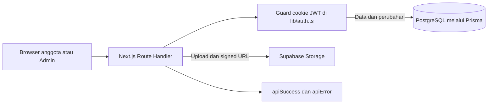

# Audit Keamanan HTN Legacy

Tanggal audit: 2026-10-23
Mode: pemeriksaan statis, tanpa perubahan source code dan tanpa menjalankan tes.
Commit code lokal yang ditinjau: `15ffde4`
Commit `main` GitHub saat audit: `1ed042df96440efa34acb6174a733e692863ce9f`

## Ringkasan

| Tingkat | Jumlah |
| --- | ---: |
| Kritis bersyarat | 1 |
| Tinggi | 1 |
| Sedang | 3 |
| Rendah | 1 |

Rekomendasi: **CONDITIONAL**. Jangan menganggap secret historis aman sebelum seluruh nilainya dipastikan sudah dirotasi. Mekanisme Admin juga perlu perlindungan percobaan login dan kredensial individual untuk menjaga batas akses dan atribusi.

## Konteks dan batas kepercayaan

Codebase memuat 115 file di bawah `src/`. Pemeriksaan difokuskan pada route autentikasi, session JWT, API anggota/kas/receipt/settings, helper enkripsi, Prisma, Supabase Storage, serta perubahan lokal setelah commit PR #39.

- Identitas datang dari request publik, form, dan cookie browser. Server memvalidasi body dengan Zod pada route yang menerima input.
- Cookie Anggota dan Admin terpisah. Cookie memakai `httpOnly`, `sameSite: "lax"`, dan `secure` saat `NODE_ENV=production` (`src/lib/auth.ts:76-99`). Token diverifikasi dengan `jose` dan masa berlaku Admin ditetapkan 30 menit (`src/lib/auth.ts:56-73`, `90-115`).
- API Admin memanggil `isAdmin()` secara eksplisit. API bersama memanggil `requireMemberOrAdmin()` lalu membatasi field anggota (`src/lib/auth.ts:141-194`, `src/app/api/anggota/route.ts:17-57`).
- Metadata receipt disimpan di PostgreSQL; file lewat adapter storage dan UI menerima signed URL (`src/lib/storage.ts:21-35`, `140-163`).
- Area berisiko tertinggi adalah login Admin dengan satu password bersama, penyimpanan password anggota yang dapat dibalik, pembatasan percobaan upload di memori, serta secret yang dicatat masih ada dalam histori Git.

## Temuan

### Kritis bersyarat: secret historis berada di repository publik

**Bukti:** `TODO.md:237-239` dan `TODO.md:263-264` menyatakan `JWT_SECRET`, `ENCRYPTION_KEY`, dan `ADMIN_PASSWORD` versi lama terdapat pada commit `dfa0935` dan `88d6f99`, serta menyebut rotasi belum diselesaikan. Metadata GitHub yang diperiksa pada tanggal audit menunjukkan repository `htnuinar26/htn-legacy` bersifat publik.

**Dampak:** Jika salah satu nilai historis masih aktif, orang yang dapat membaca histori publik dapat memalsukan token sesi dengan signing key, mendekripsi password anggota dengan encryption key, atau masuk sebagai Admin dengan password bersama. Nilai secret tidak disalin ke laporan ini.

**Eksploitasi:** Pengunjung repo membaca objek commit lama, mencoba secret yang terekspos terhadap konfigurasi deployment. Jika `JWT_SECRET` masih aktif, token Admin yang ditandatangani dengan key itu dapat diterima `jwtVerify()` (`src/lib/auth.ts:67-73`). Jika `ADMIN_PASSWORD` masih aktif, endpoint Admin menerima password tersebut (`src/lib/auth.ts:130-135`, `src/app/api/auth/admin-login/route.ts:34-42`).

**Tingkat:** Kritis apabila nilai historis masih aktif. Status rotasi tidak dapat dibuktikan dari source code.

**Tindakan yang disarankan:** Perlakukan seluruh nilai historis sebagai bocor; rotasi JWT, encryption, dan password Admin sebelum deployment, cabut sesi lama dengan mengganti JWT key, kemudian koordinasikan pembersihan histori dengan pemilik repo. Jangan mengandalkan penghapusan file `.env` pada commit terbaru.

### Tinggi: autentikasi Admin memakai satu password bersama tanpa pembatasan percobaan

**Bukti:** `verifyAdminPassword()` membandingkan input dengan satu `ADMIN_PASSWORD` (`src/lib/auth.ts:130-135`). Login Admin memeriksa nama dari daftar, lalu memakai verifikasi password bersama dan menerbitkan role Admin (`src/app/api/auth/admin-login/route.ts:26-44`). Skema hanya mewajibkan password tidak kosong (`src/app/api/auth/admin-login/route.ts:10-13`). Login anggota dan registrasi juga tidak memanggil rate limiter (`src/app/api/auth/login/route.ts:20-53`, `src/app/api/auth/signup/route.ts:24-62`).

**Skenario:** Penyerang mengirim banyak POST ke `/api/auth/admin-login` dengan satu dari empat nama dan tebakan password. Tidak ada limiter aplikasi pada route tersebut. Ketika password diketahui oleh siapa pun, pemegangnya dapat memilih nama Admin mana saja karena nama bukan kredensial individual.

**Dampak:** Pengambilalihan Admin membuka route untuk membaca data anggota, mengubah status pembayaran, menyetujui receipt, mengubah settings, dan menghapus transaksi. Pemilihan nama pada dropdown tidak membuktikan identitas orang yang login.

**Tingkat:** Tinggi. Keberadaan WAF atau rate limit eksternal tidak dapat diverifikasi dari repository.

**Tindakan yang disarankan:** Terapkan pembatasan percobaan terpusat di lapisan yang berjalan lintas instance. Untuk atribusi Admin, gunakan autentikasi individual atau faktor tambahan; password bersama saja tidak dapat membedakan empat pemegang akun.

### Sedang: password anggota disimpan sebagai ciphertext yang dapat dipulihkan dan minimum hanya empat karakter

**Bukti:** `encryptPassword()` menyimpan `IV || tag || ciphertext` AES-256-GCM (`src/lib/crypto.ts:26-36`) dan `verifyPassword()` mendekripsi kembali menjadi plaintext untuk membandingkan password (`src/lib/crypto.ts:43-55`). Registrasi menerima password empat karakter (`src/app/api/auth/signup/route.ts:15-20`); pembuatan anggota Admin memakai batas minimum yang sama (`src/app/api/anggota/route.ts:63-74`).

**Skenario dan dampak:** Jika database dan `ENCRYPTION_KEY` sama-sama terekspos, seluruh password dapat dipulihkan, bukan hanya diuji satu per satu seperti pada password hash yang lambat. Password empat karakter juga mudah ditebak bila dipakai ulang. Risiko meluas ke layanan lain apabila anggota menggunakan ulang password.

**Tingkat:** Sedang. GCM memberi kerahasiaan dan autentikasi ciphertext, tetapi bukan pengganti password hashing.

**Tindakan yang disarankan:** Rencanakan migrasi ke password hashing adaptif seperti Argon2id atau bcrypt dengan alur migrasi/reset yang menjaga akun lama tetap dapat masuk. Naikkan kebijakan panjang password dan tambah pembatasan login.

### Sedang: pembatasan upload receipt mudah melemah pada deployment multi-instance

**Bukti:** Rate limiter disimpan pada `Map` proses lokal (`src/app/api/struk/upload/route.ts:24-26`, `43-54`). Kunci IP diambil dari nilai pertama `x-forwarded-for` tanpa validasi trusted proxy (`src/app/api/struk/upload/route.ts:28-36`). Pemanggilan memakai nullish coalescing (`src/app/api/struk/upload/route.ts:133-136`), sehingga pemeriksaan kedua per anggota hanya dijalankan bila pemeriksaan IP mengembalikan nilai non-null, bukan pada request yang diizinkan.

**Dampak:** Counter tidak dibagi antar instance serverless dan hilang saat instance diganti. Jika klien dapat memengaruhi nilai pertama `x-forwarded-for` pada jalur deployment, ia dapat berganti key untuk melewati batas per sumber. Daftar `Map` tidak membersihkan key lama secara berkala.

**Tingkat:** Sedang, dengan exploitability bergantung pada bagaimana proxy deployment menulis header forwarded.

**Tindakan yang disarankan:** Gunakan limiter terpusat yang mempercayai alamat klien hanya dari proxy yang ditentukan, periksa IP dan anggota secara eksplisit, serta bersihkan state kedaluwarsa.

### Sedang: audit log tidak mencatat identitas Admin yang dipilih

**Bukti:** Login menyimpan `nama` pilihan ke payload Admin (`src/app/api/auth/admin-login/route.ts:42-44`). Namun route aksi Admin menulis `actorNama: "Bendahara"` secara tetap, misalnya transaksi (`src/app/api/transaksi/route.ts:153-160`), verifikasi receipt (`src/app/api/struk/[id]/verify/route.ts:113`, `184`), settings (`src/app/api/settings/route.ts:102-109`), barcode (`src/app/api/settings/barcode/route.ts:84-93`), dan generator (`src/app/api/admin/struk-generator/route.ts:160-173`).

**Dampak:** Audit log tidak dapat mengidentifikasi Admin yang melakukan perubahan. Ini melemahkan penyelidikan insiden dan membuat identitas yang tampil pada session tidak konsisten dengan jejak audit.

**Tingkat:** Sedang untuk integritas audit; tidak ditemukan jalur eskalasi hak dari temuan ini sendiri.

**Tindakan yang disarankan:** Ambil identitas dari session Admin terverifikasi dan simpan sebagai actor untuk seluruh aksi Admin.

### Rendah: endpoint login anggota memungkinkan enumerasi nama akun

**Bukti:** `/api/auth/login` mengembalikan `NOT_FOUND` untuk nama yang tidak ada, tetapi `AUTH_ERROR` untuk password salah (`src/app/api/auth/login/route.ts:38-52`). Ini juga digunakan UI untuk mengarahkan akun yang belum ada ke signup.

**Dampak:** Pemanggil tanpa autentikasi dapat membedakan nama anggota yang terdaftar. Perilaku ini sesuai fitur redirect yang diminta, tetapi dapat dipakai untuk mengumpulkan daftar nama.

**Tingkat:** Rendah, sebagian dampak dikurangi karena direktori anggota memang terlihat bagi pengguna yang sudah login (`src/app/api/anggota/route.ts:17-57`).

## Perubahan setelah PR #39 dan deployment

PR #39 telah tergabung dengan commit `1ed042df...` pada branch `main`. Namun branch lokal yang diaudit berada pada `15ffde4`; perubahan setelah commit review `8206bc8` mencakup penetapan nama Admin di kode, sesi Admin 30 menit, dan dropdown custom. Pemeriksaan GitHub saat audit menunjukkan `main` masih di `1ed042df...`, sehingga perubahan lanjutan tersebut belum termasuk dalam commit `main` yang terverifikasi. Periksa status branch dan deployment production sebelum menganggap perbaikan tersebut telah tayang.

## Audit GitHub Actions

- Tidak ada direktori `.github/workflows/` pada checkout yang diaudit.
- Workflow yang ditemukan: 0.
- Integrasi aksi agent AI yang dapat dianalisis: 0.
- Hasil skill `agentic-actions-auditor`: tidak ditemukan workflow, sehingga tidak ada attack path agentic CI yang dapat dinilai pada repository lokal ini.

## Cakupan, uji, dan batasan

- Dibangun konteks batas kepercayaan dengan mengikuti alur Route Handler, helper auth, Prisma, dan Supabase Storage.
- Meninjau perubahan lokal secara diferensial dari `8206bc8` ke `15ffde4`, menelusuri `git blame` untuk helper autentikasi dan route login, serta menghitung titik penggunaan guard Admin. Ada 16 kemunculan `isAdmin()` di bawah `src/app/api/` dan tujuh pemanggilan langsung `getAdminSession()` di `src/` pada checkout ini.
- Menemukan 115 file source di bawah `src/`; fokus audit pada permukaan autentikasi, otorisasi, data finansial, file, dan session. Ini bukan review manual seluruh 115 file.
- Direktori `tests/` berisi tiga skrip build/runtime container dan tidak menunjukkan rangkaian tes keamanan untuk login/session/API. Tes tidak dijalankan karena permintaan adalah audit tanpa perubahan code.
- Tidak membaca atau menyalin isi `.env` maupun nilai secret dari histori.
- Metadata repository publik dan commit `main` diperiksa melalui GitHub API pada waktu audit. Konfigurasi WAF, environment produksi, status rotasi secret, dan kontrol dashboard Vercel tidak dapat diverifikasi dari source.
- Skill yang digunakan: `audit-context-building`, `differential-review`, dan `agentic-actions-auditor`.
- Keyakinan: tinggi untuk alur source yang dikutip; sedang untuk exploitability yang bergantung pada konfigurasi proxy dan status secret deployment.
